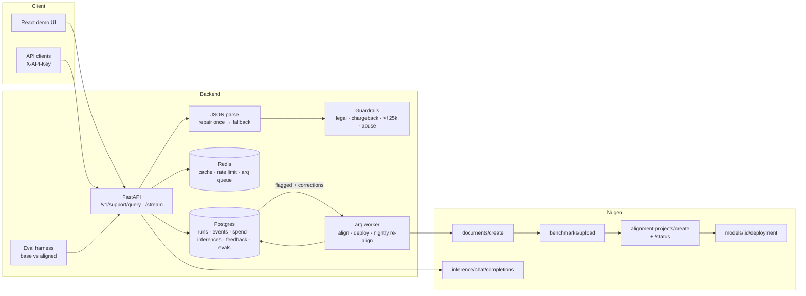

# Brand Support Copilot

A production-shaped customer-support backend for **Urbane Threads**, a fictional India-only D2C
apparel brand (own site + Amazon + Flipkart). It uses a **Nugen domain-aligned model** that has
learned the brand's policies (returns, refunds, shipping, GST, warranty, marketplace rules,
escalation), and wraps it in a strict-JSON API with guardrails, caching, rate limiting, an eval
harness and a feedback → re-alignment loop.

> Built for the Nugen Intelligence Senior Backend Engineer exercise.
> Stack: Python 3.12 · FastAPI · SQLAlchemy 2 + Alembic · PostgreSQL · Redis · arq · httpx ·
> Docker · Kubernetes · Terraform (Azure) · GitHub Actions · React/Vite UI.

## The problem

Support agents (human or AI) for a multi-channel D2C brand get the details wrong in the costly
places: a 30-day return window that was cut to 7, a refund promised on an Amazon order the brand
can't refund, a chargeback threat that should have gone to a human. A general LLM doesn't know
the brand's rules; prompt-stuffing all policies is slow and brittle; and you need to *measure*
whether the model follows policy and improve it from production feedback.

## Architecture



## How Nugen alignment is used

Every endpoint below was verified against `https://api.nugen.in/openapi-public.json` and the
`nugen-cookbook` (see [PLAN.md](PLAN.md) for request/response shapes).

1. **Docs** — 15 active policy docs + 3 distractors (a SUPERSEDED 2024 returns policy, an
   archived FAQ with conflicting rules, a marketing page) in [data/docs](data/docs). Each is
   Markdown and ≥500 words (Nugen rejects shorter docs; the pipeline checks before uploading).
2. **Upload** — `POST /api/v3/documents/create` (multipart), poll `GET /documents/{id}/status`.
3. **Benchmark** — a curated 30-sample Q&A set ([data/benchmark](data/benchmark)) via
   `POST /api/v3/benchmarks/upload`, so Nugen's built-in evaluation has policy-correct ground
   truth. It is separate from the 40-question held-out eval.
4. **Align** — `POST /api/v3/alignment-projects/create` on `Qwen/Qwen2.5-0.5B-Instruct`, then
   poll `GET /alignment-projects/{id}/status` until READY.
5. **Deploy** — `POST /api/v3/models/{model_id}/deployment`, poll `/deployment/status` until
   DEPLOYED (`UNDEPLOYED` + `error` = failed).
6. **Infer** — `POST /api/v3/inference/chat/completions` with the aligned `model_id`; the API
   maps Nugen's `confidence_score` (inference-time uncertainty, aligned models only) to
   `confidence`.

The pipeline is **idempotent and resumable**: every Nugen id is committed to Postgres when it is
created, the run is keyed by a hash of (docs + benchmark + base model), and transient failures
leave the run resumable instead of re-uploading or re-paying.

```bash
python -m app.cli models          # alignment-ready base models (free)
python -m app.cli align           # upload docs + benchmark (free), stops before paid step
python -m app.cli align --yes     # start alignment and wait for READY
python -m app.cli deploy          # deploy + wait for DEPLOYED
python -m app.cli status          # step timeline (add --refresh for live Nugen status)
python -m app.cli spend           # spend log summary
python -m app.eval run --label initial
python -m app.cli realign --yes   # re-align from feedback corrections
```

## API

| Method | Path | Notes |
|---|---|---|
| POST | `/v1/support/query` | `{query, model: aligned\|base}` → `{intent, answer, policy_ref, escalate_to_human, confidence, model_id, latency_ms, …}` |
| POST | `/v1/support/stream` | SSE: `meta`, `token`, `answer_delta`, `confidence`, `final` |
| POST | `/v1/feedback` | thumbs up/down + correction |
| GET | `/v1/feedback/flagged`, `/v1/feedback/stats` | auto- and human-flagged answers |
| GET/POST | `/v1/realign/dataset`, `/v1/realign` | build the corrections dataset, queue re-alignment |
| GET/POST | `/v1/pipeline/runs`, `/v1/pipeline/align`, `/v1/pipeline/deploy` | timeline + arq jobs |
| GET | `/v1/eval/latest`, `/v1/eval/history` | eval reports |
| GET | `/v1/spend`, `/v1/models`, `/health`, `/ready` | ops |

Auth: `X-API-Key` (or `Authorization: Bearer`). Every response has an `X-Request-ID`; logs are
JSON lines with the request id, and secrets are redacted by the formatter.

**Answer pipeline:** Redis cache (normalised query + model id) → model → strict Pydantic parse
(fenced / chatty output tolerated) → **one repair retry** → **safe fallback** that escalates →
deterministic guardrails that can only *raise* escalation. Upstream errors also fall back to a
human hand-off, flagged in the log.

## Quickstart

```bash
cp .env.example .env            # put NUGEN_API_KEY in .env (never committed)
docker compose --profile app up --build
# API  http://localhost:8000/docs   ·   UI  http://localhost:8080
```

Local dev:

```bash
docker compose up -d postgres redis
uv sync && uv run alembic upgrade head
uv run uvicorn --factory app.api.main:create_app --reload
uv run arq app.worker.WorkerSettings
uv run pytest -q                # needs the postgres/redis containers
```

## Eval results

_Pending: no Nugen API key was available while this was built, so the real base-vs-aligned
numbers have not been produced yet. `python -m app.eval run` writes them to
[reports/eval_report.md](reports/eval_report.md)._

## Spend log

Every paid call (inference, alignment) is written to the `spend_log` table with endpoint,
tokens and estimated cost; a hard stop refuses paid calls once estimated spend reaches
`NUGEN_SPEND_HARD_LIMIT_USD` ($40). Nugen does not publish per-token prices in its API docs, so
the estimate uses `NUGEN_PRICE_PER_MTOK_USD` (see [OPEN_QUESTIONS.md](OPEN_QUESTIONS.md)).

## Trade-offs

- **0.5B base model** — cheap and fast, so alignment gains are easy to see, but strict JSON is
  hard for it. That is why the repair and fallback path and the guardrails exist.
- **No RAG at answer time** — on purpose, so the eval measures what alignment taught the model.
  In production I'd add retrieval of the cited policy as a second line of defence.
- **Guardrails can only escalate** — false positives send a few extra tickets to humans, which
  costs much less than a missed legal threat.
- **Upstream failure → HTTP 200 with a fallback hand-off** — good for the customer; outages
  show up in logs and flags rather than 5xx rates, so alert on the `fallback` rate.
- **Fixed-window rate limit** — simple and atomic in Redis; a sliding window or token bucket
  would smooth bursts at the window edge.

## Next steps

- Add the cited policy's text to the prompt (retrieval) and run the eval with and without it.
- Use Nugen `POST /evaluations/create` in CI to gate a re-aligned model before promotion.
- Canary routing between old and re-aligned models, with automatic rollback on eval regression.
- OpenTelemetry traces across API → Nugen; a Prometheus metric for the fallback rate.

## Repo map

```
app/nugen/      typed async Nugen client (retries, SSE, usage, spend guard)
app/pipeline.py resumable alignment state machine     app/cli.py   operator CLI
app/support/    prompt, parser, guardrails, cache, service
app/api/        FastAPI app, auth, rate limit, routes  app/worker.py arq jobs + cron
app/eval/       scoring + runner + report              app/feedback.py feedback loop
data/           policy docs, benchmark, eval set       infra/        k8s + Terraform
ui/             React demo UI                          reports/      eval reports
```

Decisions are logged in [DECISIONS.md](DECISIONS.md) (all VETOABLE), open questions in
[OPEN_QUESTIONS.md](OPEN_QUESTIONS.md).
