# Brand Support Copilot

A production-shaped customer-support backend for **Urbane Threads**, a fictional India-only D2C
apparel brand (own site + Amazon + Flipkart). It uses a **Nugen domain-aligned model** that has
learned the brand's policies (returns, refunds, shipping, GST, warranty, marketplace rules,
escalation), and wraps it in a strict-JSON API with guardrails, caching, rate limiting, an eval
harness and a feedback → re-alignment loop.

> Built for the Nugen Intelligence Senior Backend Engineer exercise.
> Stack: Python 3.12 · FastAPI · SQLAlchemy 2 + Alembic · PostgreSQL · Redis · arq · httpx ·
> Docker · Kubernetes · Terraform (Azure) · GitHub Actions · React/Vite UI.

## Status (2026-10-22)

| Area | State |
|---|---|
| Nugen client, resumable alignment pipeline, CLI | ✅ built · tested · **run live against Nugen** |
| Support API (strict JSON, repair/fallback, SSE, cache, rate limit, auth, logs) | ✅ built · tested · served the live models |
| Eval harness (base vs aligned, 40 held-out questions) | ✅ run live twice (after alignment, after re-alignment) |
| Feedback loop + re-alignment (manual + nightly) | ✅ run live: 24 real inferences → 19 corrections → re-aligned model deployed |
| Docker / compose / k8s / Terraform / CI | ✅ images build · kubeconform 8/8 · `terraform validate` clean |
| Demo UI (5 screens, dark + light) | ✅ build + lint + WCAG contrast + 18 Playwright tests · screenshots with live data |

**Tests (2026-10-22):** 74 unit/integration tests passing (`pytest`, real Postgres + Redis), 2 live
Nugen tests passing (`pytest -m live`), ruff + mypy `--strict` clean, 3 Alembic migrations with
`alembic check` clean.

**Live run (2026-10-22, IST):**

| Step | Result |
|---|---|
| Smoke inference | ✅ `Qwen/Qwen2.5-0.5B-Instruct`, 40 tokens, 373 ms |
| Upload 18 docs + benchmark | ✅ docs READY in 22 s · `benchmark_01m5hvpw5g0evege` |
| Alignment | ✅ `alignment_01m5hvpwrp9eah3n`: QUEUED → PROCESSING → READY in 5 min 44 s → **`model_01m5hvz1m0n0bn6r`** |
| Deploy | ✅ DEPLOYED in 21 s |
| Eval: base vs aligned | ✅ 80 real inferences (table below) |
| Feedback seed | ✅ 24 real inferences on the aligned model; 19 thumbs-down + correction; 21 flagged |
| Re-alignment | ⚠️ first attempt failed with **HTTP 409**: Nugen deduplicates documents (undocumented). Fixed by uploading per file and reusing the existing `document_id`. Retry ✅ `alignment_01m5hwbrn58t8bjz`, READY in 5 min 34 s → **`model_01m5hwkzsc790kf4`**, deployed in 15 s |
| Eval after re-align | ✅ 80 real inferences (table below) |
| Cleanup | Superseded model `model_01m5hvz1m0n0bn6r` undeployed |

Earlier outage, for the record: `api.nugen.in` returned HTTP 522 on every path from 18:44 IST on
2026-10-21 (cf-ray `a4e0a435dc76052e-DEL`). It was back by 2026-10-22 (cf-ray `a4e8bb10af649387-DEL`).

### Reproduce the live run (one command)

```bash
cp .env.example .env          # add NUGEN_API_KEY
make align-and-eval
```

That runs, in order (every paid step goes through the spend guard):

```bash
docker compose up -d --wait postgres redis && uv run alembic upgrade head
uv run python -m app.cli wait-api            # blocks until api.nugen.in/health == 200
uv run python -m app.cli estimate            # logs estimate; exits 2 if it would cross the cap
uv run python -m app.cli smoke               # 1 tiny paid inference
uv run python -m app.cli align --yes         # upload docs + benchmark, align, poll to READY
uv run python -m app.cli deploy              # deploy, poll to DEPLOYED
uv run python -m app.eval run --models base,aligned --label "initial alignment"
uv run python -m app.feedback_seed           # real inferences + reviewer corrections
uv run python -m app.cli realign --yes --deploy
uv run python -m app.eval run --models base,aligned --label "after re-alignment"
uv run python -m app.cli spend
```

Each step is idempotent: re-running `make align-and-eval` after a failure resumes from the last
completed Nugen step.

## The problem

Support agents (human or AI) for a multi-channel D2C brand get the details wrong in the costly
places: a 30-day return window that was cut to 7, a refund promised on an Amazon order the brand
can't refund, a chargeback threat that should have gone to a human. A general LLM doesn't know
the brand's rules; prompt-stuffing all policies is slow and brittle; and you need to *measure*
whether the model follows policy and improve it from production feedback.

## Architecture

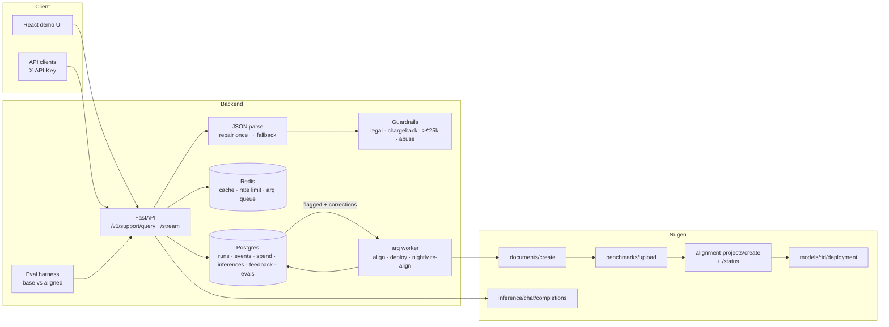

## How Nugen alignment is used

Every endpoint below was verified against `https://api.nugen.in/openapi-public.json` and the
`nugen-cookbook` (see [PLAN.md](PLAN.md) for request/response shapes).

1. **Docs** — 15 active policy docs + 3 distractors (a SUPERSEDED 2024 returns policy, an
   archived FAQ with conflicting rules, a marketing page) in [data/docs](data/docs). Each is
   Markdown and ≥500 words (Nugen rejects shorter docs; the pipeline checks before uploading).
2. **Upload** — `POST /api/v3/documents/create` (multipart), poll `GET /documents/{id}/status`.
3. **Benchmark** — a curated 30-sample Q&A set ([data/benchmark](data/benchmark)) via
   `POST /api/v3/benchmarks/upload`, so Nugen's built-in evaluation has policy-correct ground
   truth. It is separate from the 40-question held-out eval.
4. **Align** — `POST /api/v3/alignment-projects/create` on `Qwen/Qwen2.5-0.5B-Instruct`, then
   poll `GET /alignment-projects/{id}/status` until READY.
5. **Deploy** — `POST /api/v3/models/{model_id}/deployment`, poll `/deployment/status` until
   DEPLOYED (`UNDEPLOYED` + `error` = failed).
6. **Infer** — `POST /api/v3/inference/chat/completions` with the aligned `model_id`; the API
   maps Nugen's `confidence_score` (inference-time uncertainty, aligned models only) to
   `confidence`.

The pipeline is **idempotent and resumable**: every Nugen id is committed to Postgres when it is
created, the run is keyed by a hash of (docs + benchmark + base model), and transient failures
leave the run resumable instead of re-uploading or re-paying.

```bash
python -m app.cli models          # alignment-ready base models (free)
python -m app.cli align           # upload docs + benchmark (free), stops before paid step
python -m app.cli align --yes     # start alignment and wait for READY
python -m app.cli deploy          # deploy + wait for DEPLOYED
python -m app.cli status          # step timeline (add --refresh for live Nugen status)
python -m app.cli spend           # spend log summary
python -m app.eval run --label initial
python -m app.cli realign --yes   # re-align from feedback corrections
```

## API

| Method | Path | Notes |
|---|---|---|
| POST | `/v1/support/query` | `{query, model: aligned\|base}` → `{intent, answer, policy_ref, escalate_to_human, confidence, model_id, latency_ms, …}` |
| POST | `/v1/support/stream` | SSE: `meta`, `token`, `answer_delta`, `confidence`, `final` |
| POST | `/v1/feedback` | thumbs up/down + correction |
| GET | `/v1/feedback/flagged`, `/v1/feedback/stats` | auto- and human-flagged answers |
| GET/POST | `/v1/realign/dataset`, `/v1/realign` | build the corrections dataset, queue re-alignment |
| GET/POST | `/v1/pipeline/runs`, `/v1/pipeline/align`, `/v1/pipeline/deploy` | timeline + arq jobs |
| GET | `/v1/eval/latest`, `/v1/eval/history` | eval reports |
| GET | `/v1/spend`, `/v1/models`, `/health`, `/ready` | ops |

Auth: `X-API-Key` (or `Authorization: Bearer`). Every response has an `X-Request-ID`; logs are
JSON lines with the request id, and secrets are redacted by the formatter.

**Answer pipeline:** Redis cache (normalised query + model id) → model → strict Pydantic parse
(fenced / chatty output tolerated) → **one repair retry** → **safe fallback** that escalates →
deterministic guardrails that can only *raise* escalation. Upstream errors also fall back to a
human hand-off, flagged in the log.

## Quickstart

```bash
cp .env.example .env            # put NUGEN_API_KEY in .env (never committed)
docker compose --profile app up --build
# API  http://localhost:8000/docs   ·   UI  http://localhost:8080
```

Local dev:

```bash
docker compose up -d postgres redis
uv sync && uv run alembic upgrade head
uv run uvicorn --factory app.api.main:create_app --reload
uv run arq app.worker.WorkerSettings
uv run pytest -q                # needs the postgres/redis containers
```

## Eval results (real, 2026-10-22)

Same prompt for every model, with no retrieval, on 40 held-out questions. Each run sent all 40
questions to the base model and to the aligned model; base was re-run each time to show
run-to-run variance. Full reports: [reports/](reports/) (JSON per run + `eval_report.md`).

| Metric | Base (run 1) | **Aligned** `model_01m5hvz1m0n0bn6r` | Base (run 2) | **Re-aligned** `model_01m5hwkzsc790kf4` |
|---|---|---|---|---|
| Factual accuracy | 27.5% | 25.0% | 25.0% | 22.5% |
| Policy violations (lower is better) | 5.0% | 10.0% | 5.0% | 12.5% |
| Escalation correct (with guardrails) | 92.5% | 90.0% | 87.5% | 92.5% |
| Escalation correct (model only) | 85.0% | 85.0% | 80.0% | 85.0% |
| JSON valid first try / after repair | 100% / 100% | 95.0% / 100% | 100% / 100% | 92.5% / 92.5% |
| Correct `policy_ref` | 32.5% | 2.5% | 30.0% | 12.5% |
| Latency p50 / p95 | 5.9 s / 12.0 s | 5.7 s / 10.8 s | 29.5 s / 210.9 s* | 23.0 s / 186.6 s* |
| Tokens / est. cost | 20,879 / $0.0042 | 22,470 / $0.0045 | 20,833 / $0.0042 | 24,562 / $0.0049 |

**Significance:** with 40 questions, ±2.5 pp is exactly **1 question**, so differences of
2.5–5 pp (1–2 questions) are **not significant**. Only the `policy_ref` drop is a clear effect.

**Why `policy_ref` dropped (32.5% → 2.5%): model output, not scoring.** The aligned model's raw
JSON literally contains `"policy_ref": null`; this was checked on the logged raw outputs, 22 of 24
non-fallback answers. Typical example:
`{"intent": "returns", "answer": "If the blazer is returned within 7 days of delivery, a 5%
return shipping fee is applied.", "policy_ref": null, ...}`. The parser only normalises case and
whitespace and never discards a well-formed id, so there is no scoring bug. Alignment shifted the
model away from the prompt's id catalog, and it also invents intents such as `return_window`.
Eval reports now keep each raw output for this kind of diagnosis.

\* Run 2 latency hit both models equally (base included) while Nugen was also running its own
evaluation and two deployments. Treat it as queueing on Nugen's side, not a model effect.

Nugen's built-in evaluation on our 30-sample curated benchmark agrees:
binary correctness was 0.000 for base vs **0.067** for aligned, and 0.000 vs 0.000 after
re-align. Response relevance was 0.300 vs 0.283, and 0.307 vs 0.187 after re-align.

**What the numbers say.** On this setup, domain alignment of a **0.5B** model did **not** improve
policy accuracy. Aligned and base are within noise (±1 question of 40) on facts and
escalation. The aligned models got worse at citing a `policy_ref`, and slightly worse on JSON
validity and violations. Looking at the answers, the aligned model has picked up the brand's
*vocabulary* ("unworn and tagged", store credit, dispatch email) but not its *numbers*: it
invents windows such as "14 days" or "2-3 business days", and on the superseded-policy traps it
repeats the old "30-day" rule. A likely cause is that the distractor docs (SUPERSEDED policy,
archived FAQ) were in the training upload. The safety net held: guardrails kept escalation
correctness at 87.5–92.5%, and the repair/fallback path left no invalid JSON reaching a
customer. Next experiments, in order: train on ACTIVE docs only, then try a larger base
(`Qwen2.5-1.5B` / `Llama-3.2-3B` are alignment-ready), then go hybrid with retrieval of the
cited policy.

The 40 questions ([data/eval/questions.jsonl](data/eval/questions.jsonl)) cover in-window and
out-of-window returns, non-returnables, refunds, shipping/COD thresholds, delivery zones,
warranty exclusions, marketplace redirects, damage claims, GST edges, cancellation, 6
escalations, 5 superseded-policy traps, 6 Hinglish queries and 1 out-of-scope request. The
feedback seed set ([data/feedback/seed.jsonl](data/feedback/seed.jsonl)) is disjoint from it,
so the re-aligned model is never trained on eval questions.

## Screenshots

Captured on 2026-10-22 against the live backend and the deployed re-aligned model. Chat and
compare show real model answers (`LIVE=1 npx playwright test e2e/live.spec.ts`); pipeline,
eval and feedback show the real run, eval and feedback data. The mobile shots show the chat
landing state.

| | Dark | Light |
|---|---|---|
| Support chat | 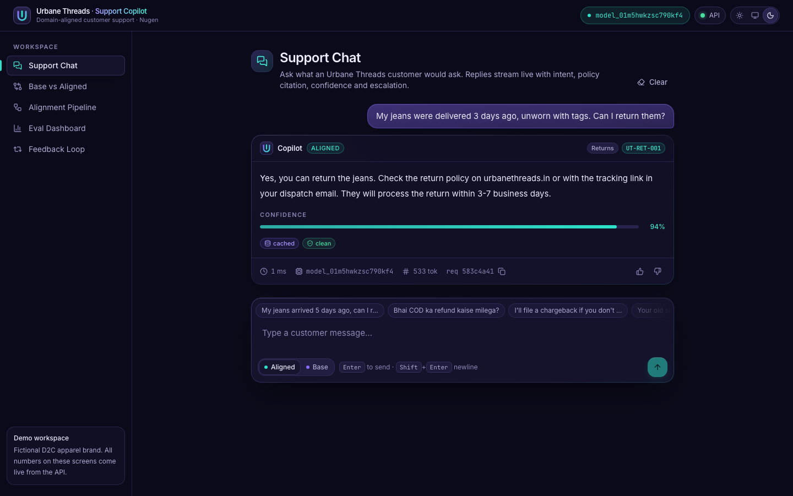 | 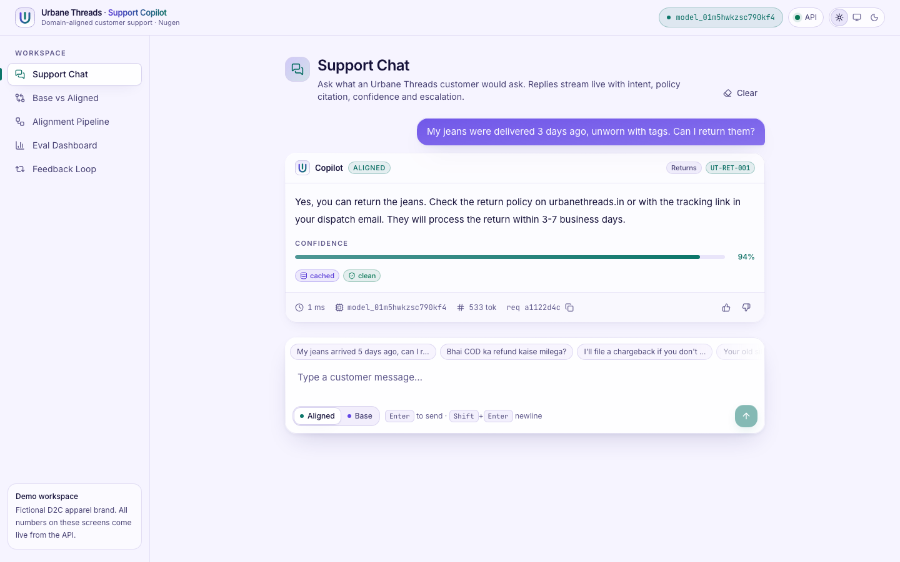 |
| Base vs aligned | 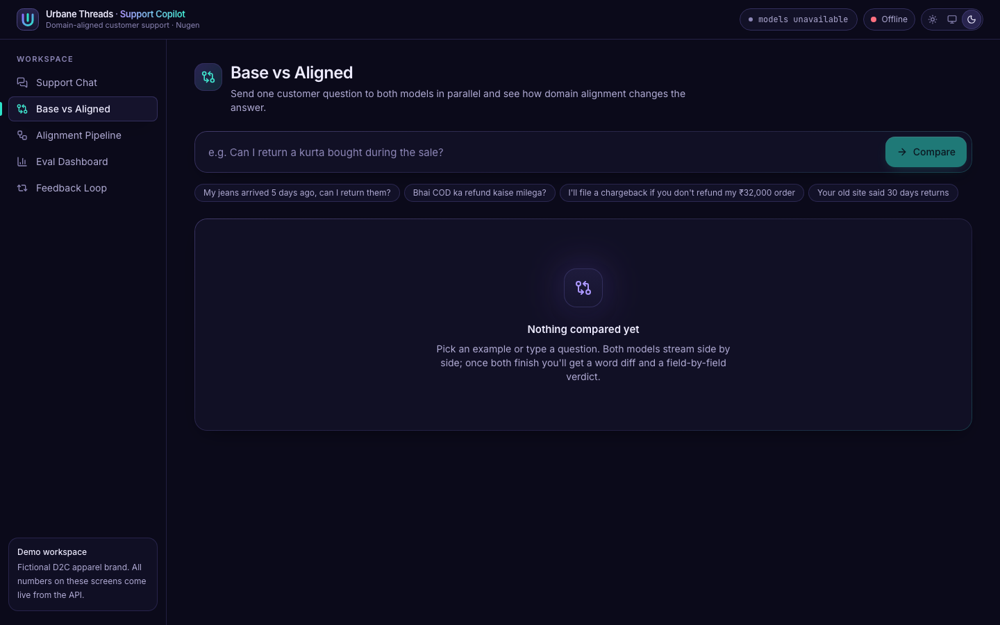 | 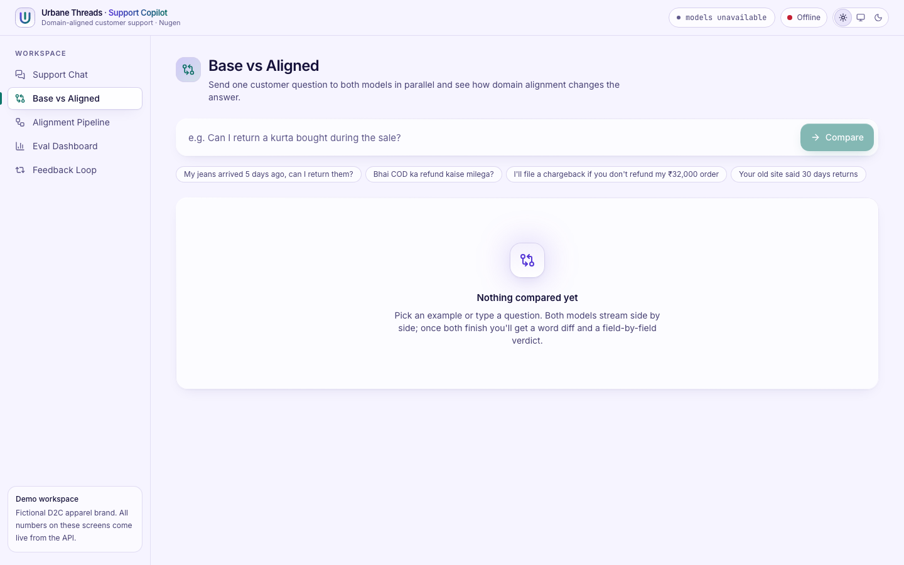 |
| Alignment pipeline | 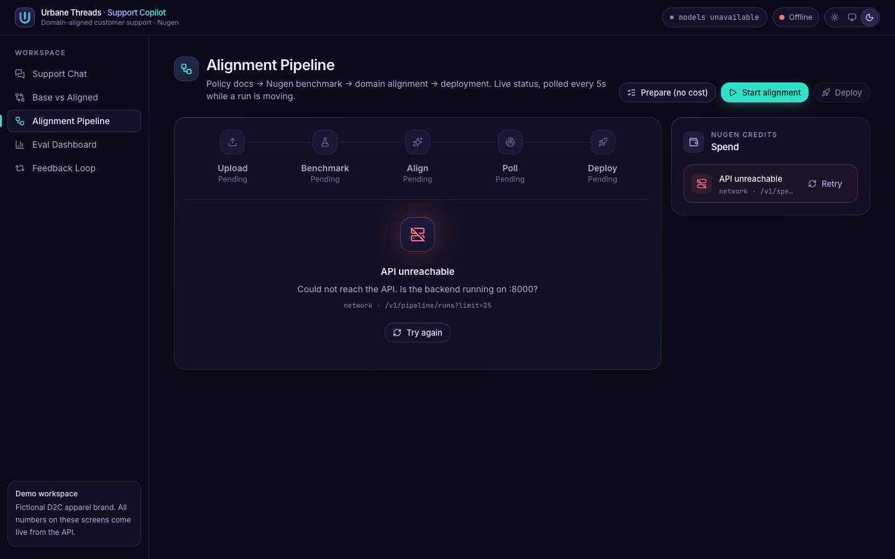 | 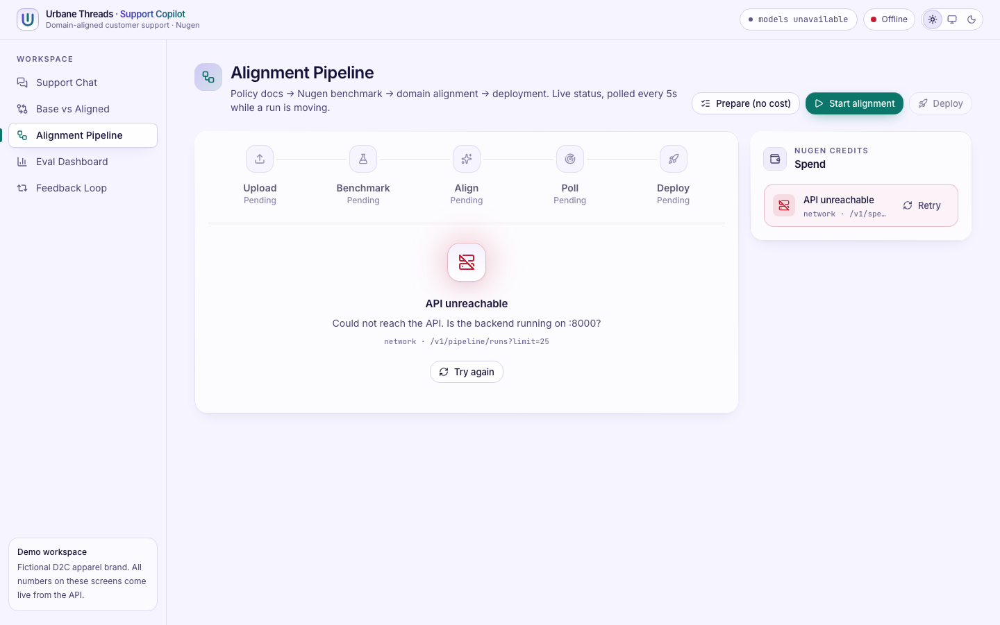 |
| Eval dashboard | 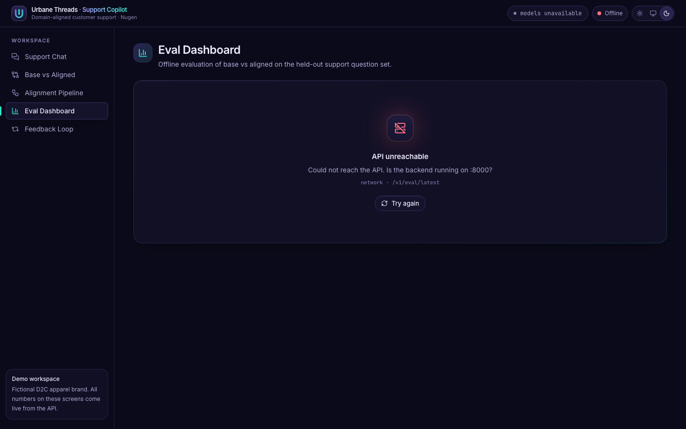 | 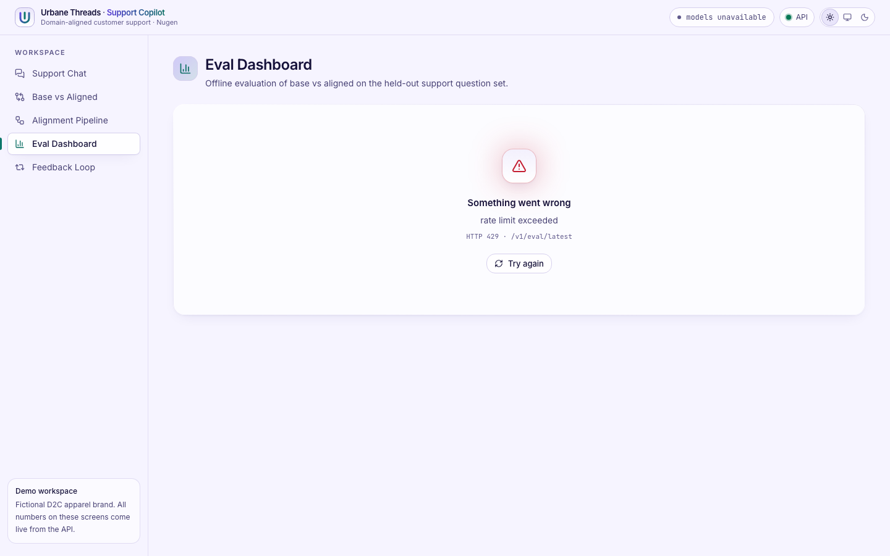 |
| Feedback loop | 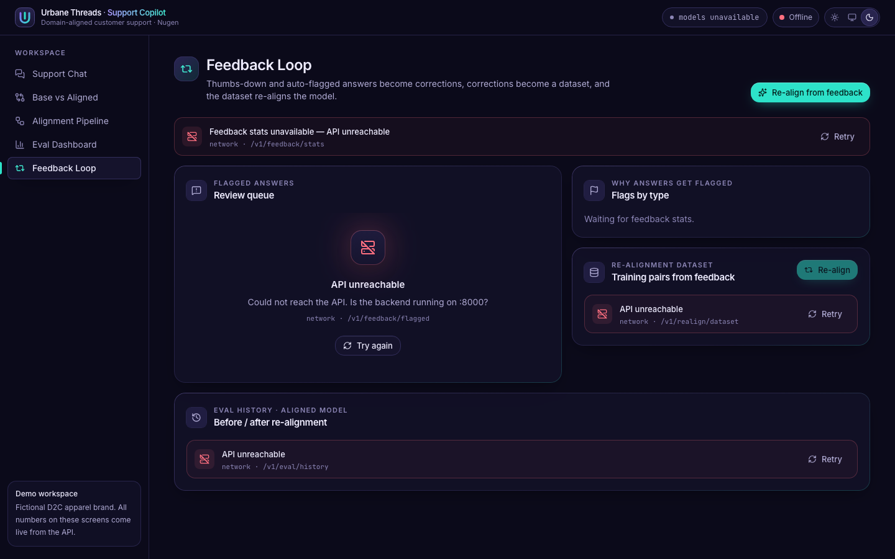 | 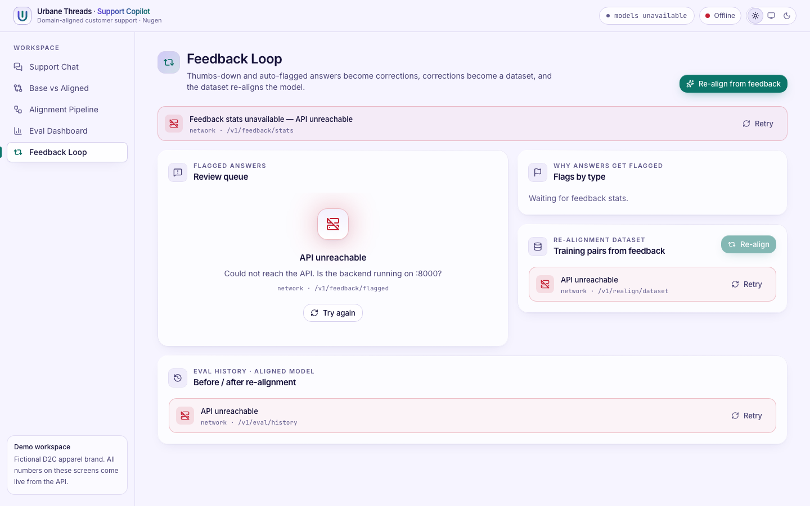 |
| Mobile chat | 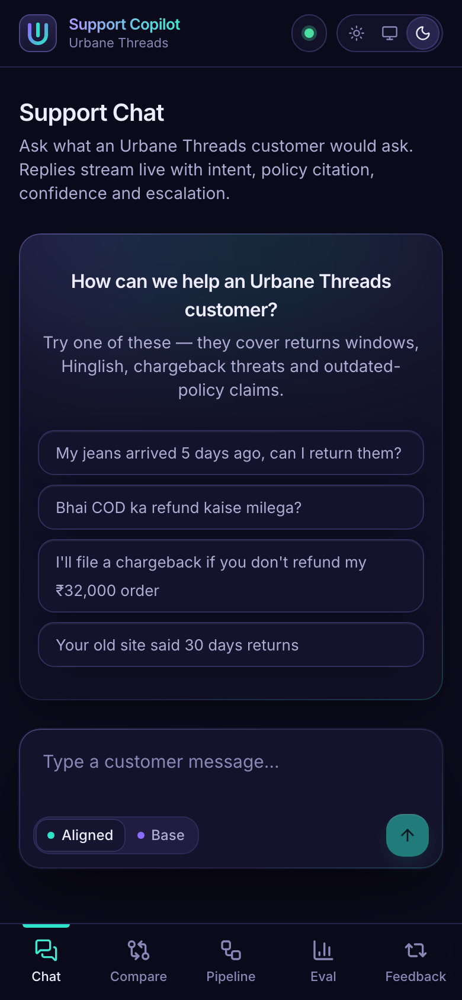 | 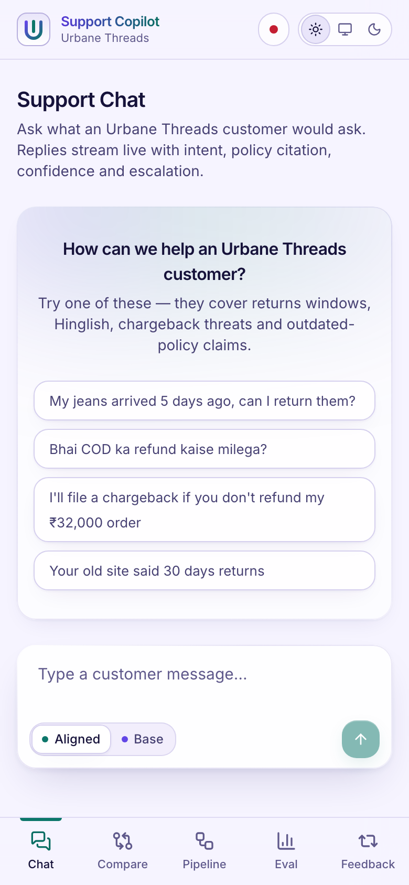 |

## Spend log

Every paid call (inference, alignment) is written to the `spend_log` table with endpoint,
tokens and estimated cost. A hard stop refuses any paid call that would push estimated spend
past `NUGEN_SPEND_HARD_LIMIT_USD` ($40). Nugen does not publish prices in its API docs, so
inference is estimated with `NUGEN_PRICE_PER_MTOK_USD` and each alignment is charged
`NUGEN_ALIGNMENT_COST_EST_USD` ($10, conservative). See [OPEN_QUESTIONS.md](OPEN_QUESTIONS.md).

| Item (live run, 2026-10-22) | Calls | Tokens | Cost in the spend log |
|---|---|---|---|
| Inference: smoke, sanity, 2 evals, feedback seed, repairs, UI screenshots | 196 | 104,889 | $0.021 (at $0.20 / 1M tokens, estimated) |
| Alignment runs | 2 | n/a | $20.00 (**placeholder**, $10 each; the real price is not exposed by the API) |
| **Total charged by the guard** | | | **$20.02 of the $40 cap** |
| Pre-run estimate (logged before any paid call) | | ~146k | $20.03 |

The real alignment cost isn't available from the API (no usage/billing endpoint; the paths
checked return 404). Reconcile against platform.nugen.in billing; see OPEN_QUESTIONS Q1/Q7.

## RAG vs Domain Alignment

My earlier project, [ecommerce-ai-ops-agent](https://github.com/Shelunagori/ecommerce-ai-ops-agent),
tackles the same e-commerce support-policy problem with **RAG**: pgvector retrieval, a LangGraph
agent and human-approved actions. This project takes the other route: it teaches the policies to
the model through **Nugen domain alignment** and calls it with no retrieval step.
Both repos use **synthetic data** (invented brands, customers and policies). The two projects
were not scored on a shared eval, so this is not a head-to-head result. On its own eval, this
repo's alignment of a 0.5B model did **not** beat its unaligned base model (see Eval results).

| Dimension | RAG (ecommerce-ai-ops-agent) | Domain alignment (this repo) |
|---|---|---|
| Knowledge updates | Re-index the changed docs (minutes) | Re-align the model (a training run) |
| Citations / grounding | Native: answer cites the retrieved chunk | `policy_ref` produced by the model, validated against the policy catalog and scored in the eval |
| Behaviour consistency + structured output | Depends on prompt + retrieved context | Intended strength (trained-in tone/format). Here, with a 0.5B base, JSON validity was 92.5–95% vs 100% for base; repair/fallback covered the gap |
| Latency / infra | Embedding + vector search hop; needs a vector DB | No retrieval hop, no vector DB |
| Uncovered topics (hallucination risk) | Needs an escalation path | Needs an escalation path (guardrails + `UT-ESC-012`) |

**Next step:** a hybrid. Use the aligned model for stable policy and behaviour, and add retrieval
only for policies that change often (sale terms, promos). Then compare all three on the same
held-out eval.

## Trade-offs

- **0.5B base model** — cheap and fast, but the live eval shows it is too small to absorb the
  policy numbers through alignment on this corpus. That is why the repair/fallback path and the
  guardrails exist, and why the next run should use a larger base.
- **No RAG at answer time** — on purpose, so the eval measures what alignment taught the model.
  In production I'd add retrieval of the cited policy as a second line of defence.
- **Guardrails can only escalate** — false positives send a few extra tickets to humans, which
  costs much less than a missed legal threat.
- **Upstream failure → HTTP 200 with a fallback hand-off** — good for the customer; outages
  show up in logs and flags rather than 5xx rates, so alert on the `fallback` rate.
- **Fixed-window rate limit** — simple and atomic in Redis; a sliding window or token bucket
  would smooth bursts at the window edge.

## Next steps

- Add the cited policy's text to the prompt (retrieval) and run the eval with and without it.
- Use Nugen `POST /evaluations/create` in CI to gate a re-aligned model before promotion.
- Canary routing between old and re-aligned models, with automatic rollback on eval regression.
- OpenTelemetry traces across API → Nugen; a Prometheus metric for the fallback rate.

## Repo map

```
app/nugen/      typed async Nugen client (retries, SSE, usage, spend guard)
app/pipeline.py resumable alignment state machine     app/cli.py   operator CLI
app/support/    prompt, parser, guardrails, cache, service
app/api/        FastAPI app, auth, rate limit, routes  app/worker.py arq jobs + cron
app/eval/       scoring + runner + report              app/feedback.py feedback loop
data/           policy docs, benchmark, eval set       infra/        k8s + Terraform
ui/             React demo UI                          reports/      eval reports
```

Decisions are logged in [DECISIONS.md](DECISIONS.md) (all VETOABLE), open questions in
[OPEN_QUESTIONS.md](OPEN_QUESTIONS.md).
