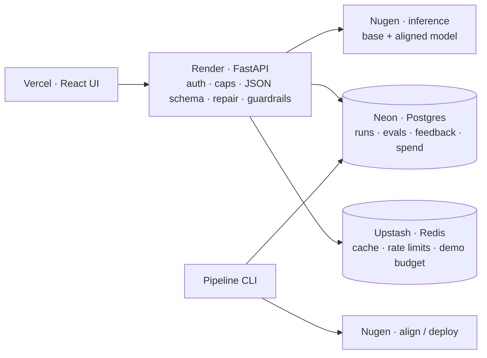
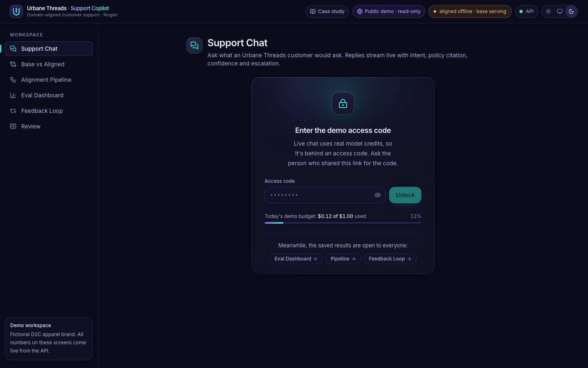

# Brand Support Copilot

A customer-support backend for **Urbane Threads**, a fictional Indian D2C fashion brand, built on
**Nugen domain alignment**. It aligns small open models to the brand's 15 support policies, serves
them through a strict-JSON FastAPI service with guardrails and a feedback loop, and measures every
aligned model against its own base model.

**Live demo:** <https://brand-support-copilot.vercel.app>, which opens on *Base vs Aligned*.
Live chat needs an access code, shared privately.<br>
**Case study:** <https://brand-support-copilot.vercel.app/review>, the full engineering write-up.

> All data is synthetic. Results are reported as measured, including the regressions.


---

## Results at a glance

Each model was scored on the same **40 held-out questions** with the same prompt and no retrieval.

| Experiment | Model | Factual accuracy | Escalation correct | JSON valid (1st try) | Correct `policy_ref` |
|---|---|---|---|---|---|
| **1** · Qwen2.5-0.5B, all docs | base | 27.5% | 92.5% | 100% | 32.5% |
| | aligned | 25.0% | 90.0% | 95.0% | 2.5% |
| **1b** · same model, re-aligned from feedback | base | 25.0% | 87.5% | 100% | 30.0% |
| | re-aligned | 22.5% | 92.5% | 92.5% | 12.5% |
| **3** · Llama-3.2-3B, active docs only | base | 30.0% | 92.5% | 100% | 47.5% |
| | aligned | 12.5% | 72.5% | 57.5% | 40.0% |
| **3** + JSON repair (*offline re-score of the saved answers, not a new run*) | aligned | 37.5% | 92.5% | 100% | 45.0% |

**What this shows**
- **As run, alignment did not beat the base model** in any of the three experiments.
- **Experiment 3's drop came from one formatting slip.** The aligned model wrote `"policy_ref": UT-RET-001` without quotes, which broke 17 of 40 answers. A deterministic repair for that one field fixes all 17 (offline re-score). That puts the model 3 questions ahead of its base, which is not significant.
- **±2.5 pp is one question.** Gaps of 1–2 questions are noise at n = 40.
- **The guardrails held.** Escalation stayed at 87.5–92.5% whenever the JSON parsed, and no invalid JSON ever reached a customer.

Full reports are in [`reports/`](reports/), and the Eval Dashboard in the demo shows the same data.

---

## What it does

- **Alignment pipeline:** upload docs → benchmark → align → poll → deploy on Nugen. It can resume after a crash, and every Nugen id is saved in Postgres.
- **Support API:** `POST /v1/support/query` (and an SSE stream) always returns `{intent, answer, policy_ref, escalate_to_human, confidence}`.
- **Safety net in plain code:** schema validation, a narrow JSON repair, one retry, then a safe "hand off to a human" fallback. Rule-based guardrails escalate legal threats, chargebacks, orders above ₹25,000 and abuse.
- **Eval harness:** base vs aligned on 40 held-out questions, scoring facts, policy violations, escalation, JSON validity and latency.
- **Feedback loop:** thumbs-down + correction → re-alignment dataset → re-align. The eval questions are never used for training.
- **Public demo mode:** results screens are open to everyone; live chat sits behind an access code with daily, lifetime and per-IP caps. Paid actions are disabled, and no key ever reaches the browser.

## Architecture



The model only writes the answer JSON. Everything else (caps, auth, validation, repair,
guardrails, fallback) is deterministic code.

## Run it locally

```bash
cp .env.example .env              # add NUGEN_API_KEY (never committed)
make demo-api                     # Postgres + Redis + migrations + API on :8000
make demo-ui                      # UI on http://localhost:5173
```

Reproduce the experiments against the real Nugen API (paid; every step goes through the spend guard):

```bash
make align-and-eval               # align → deploy → eval → feedback → re-align → eval
python -m app.cli status          # step timeline of every run
python -m app.cli spend           # spend log
```

Deploying the public demo (Vercel + Render + Neon + Upstash) is a step-by-step guide in
[`docs/DEPLOY.md`](docs/DEPLOY.md).

## Cost

Real figures from the Nugen billing page (₹, converted at ₹96.28 = $1):

| Item | Billed |
|---|---|
| Alignment, Qwen 0.5B (initial / re-align) | ₹708.50 / ₹756.68 |
| Experiment 3 (3B alignment + eval) + first demo chats | ₹386.54 |
| One live Compare call (base + aligned) | ₹0.73 |
| Keeping the aligned model deployed while idle | **₹0** (deployed since 21:17 IST, 23 Oct; billing shows usage lines only) |
| **Total used** | **₹2,027.91 of ₹4,813.93** (24 Oct) |

Spend is capped in code. A lifetime cap based on the billed total refuses paid calls, and the public
demo has its own Redis caps plus per-IP limits. Estimates use Nugen's published rate card, per
million words at ~0.75 words per token.

## Tests

- **123 backend tests** (pytest on real Postgres + Redis), plus 2 opt-in live Nugen tests.
- **41 Playwright tests**: 32 run fully mocked; the rest need a live backend.
- **CI** (GitHub Actions, 6 jobs): ruff, mypy `--strict`, pytest + `alembic check`, Docker build, Terraform + kubeconform, UI lint + build.

## Learn more

| | |
|---|---|
| [Case study (`/review`)](https://brand-support-copilot.vercel.app/review) | Architecture, pipeline, results, safety, cost, Nugen platform notes |
| [`DECISIONS.md`](DECISIONS.md) | Every design decision, each marked VETOABLE |
| [`OPEN_QUESTIONS.md`](OPEN_QUESTIONS.md) | Open questions and the default taken for each |
| [`docs/DEPLOY.md`](docs/DEPLOY.md) | Public demo deployment and day-2 operations |
| [`reports/`](reports/) | Raw eval reports (JSON + Markdown) |
| [Previous project: RAG agent](https://github.com/Shelunagori/ecommerce-ai-ops-agent) | The same support-policy problem solved with RAG; compared on the case-study page |

<details>
<summary><b>Repo map</b></summary>

```
app/nugen/       typed async Nugen client (retries, SSE, usage, spend guard)
app/pipeline.py  resumable alignment state machine         app/cli.py      operator CLI
app/support/     prompt, parser + JSON repair, guardrails, cache, service
app/api/         FastAPI app, auth tiers, rate limits, routes
app/eval/        scoring, runner, offline re-score         app/feedback.py feedback loop
app/demo*.py     demo budget, Neon seeding, snapshot, live smoke test
data/            policy docs, benchmark, eval set, feedback seed
ui/              React UI (Compare, Chat, Pipeline, Eval, Feedback, Review)
infra/           Kubernetes manifests + Azure Terraform (plan-only)
```
</details>

<details>
<summary><b>More screenshots</b></summary>

| Eval dashboard | Alignment pipeline | Access gate |
|---|---|---|
|  |  |  |
</details>
